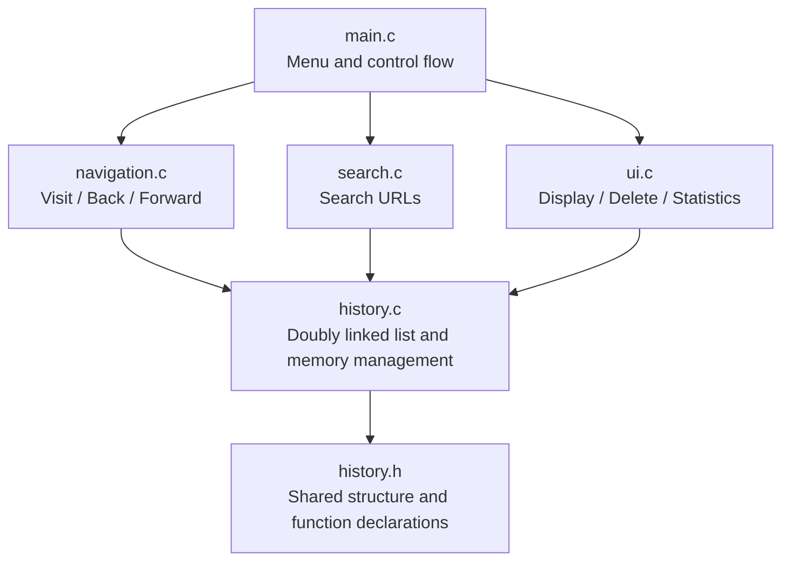

<div align="center">

# Browser History Management System

### A browser-navigation simulator built with C11 and Doubly Linked Lists


A menu-driven command-line application that simulates browser history navigation,
including visiting pages, moving backward and forward, searching, deleting entries,
and managing the current browsing session.

</div>

---

## Overview

The **Browser History Management System** is a Data Structures and Algorithms project
implemented in **C11**. It uses a dynamically allocated **doubly linked list** to
represent browsing history.

Each visit is stored as a separate node. The `current` pointer tracks the selected
page, while `prev` and `next` links support backward and forward navigation.

> This is an educational console simulation. It stores URL strings and does not open
> websites or control a real web browser.

## Features

- **Visit a page** – add a URL to browsing history. If no `://` scheme is supplied,
  the program adds `https://`.
- **Back and Forward** – navigate through the list using the current node's links.
- **Branch cleanup** – visiting a new page after going Back removes the obsolete
  forward history.
- **View history** – display entries in chronological order.
- **Search history** – find URL matches using case-insensitive partial searching.
- **Delete an entry** – remove a selected history entry.
- **Clear history** – clear all entries after confirmation.
- **Current page and statistics** – display the selected page and history statistics.
- **Memory management** – dynamically allocate nodes and free memory during deletion,
  branch cleanup, and program exit.

## Project Structure

```text
BrowserHistorySystem/
├── history.h          # Structures, constants, shared declarations, prototypes
├── history.c          # List state, input helpers, allocation and cleanup
├── navigation.c       # Visit, Back, Forward and current-page operations
├── search.c           # Case-insensitive URL search
├── ui.c               # History display, deletion and statistics
├── main.c             # Menu and application entry point
├── Makefile           # Build and clean commands
├── README.md          # Project documentation
├── TEAM_DIVISION.md   # Team roles and responsibilities
└── TEST_CASES.md      # Test scenarios
```

## Architecture

The application is separated into modules so that navigation, list management,
searching, and display operations remain organized.



## Data Structure

Each history entry is represented by a node:

```c
typedef struct HistoryNode {
    char url[URL_MAX + 1];
    time_t visited_at;
    struct HistoryNode *prev;
    struct HistoryNode *next;
} HistoryNode;
```

The list maintains three important pointers:

| Pointer | Purpose |
|---|---|
| `head` | First history entry |
| `tail` | Last history entry |
| `current` | Currently selected page |

### How navigation works

- **Visit:** create a node and link it into the list.
- **Back:** move `current` to `current->prev`.
- **Forward:** move `current` to `current->next`.
- **Visit after Back:** free the nodes after `current`, then add the new page.
- **Delete:** reconnect neighboring nodes, update list endpoints/current when needed,
  and free the removed node.

## Time Complexity

Let `n` be the number of history entries, `k` the number of forward entries removed
when visiting after Back, and `L` the URL/search comparison length.

| Operation | Time complexity |
|---|---:|
| Visit at the current tail | O(1) |
| Visit after Back | O(k) for branch cleanup; insertion is O(1) |
| Back / Forward | O(1) |
| Display history | O(n) |
| Search | O(n × L) with naive substring comparison |
| Delete by entry number | O(n) to locate + O(1) to unlink |
| Clear all history | O(n) |
| Space | O(n) |

## Build and Run

### Requirements

- GCC compiler
- Make (optional, for the Makefile workflow)

### Windows (MinGW GCC / PowerShell)

Open a terminal in the project folder and run:

```powershell
gcc -std=c11 -Wall -Wextra -Wpedantic main.c history.c navigation.c search.c ui.c -o browser_history.exe
.\browser_history.exe
```

### Linux / macOS

```bash
make
./browser_history
```

To remove the generated executable:

```bash
make clean
```

## Input and Limitations

- Maximum URL length: **255 characters**.
- Timestamps use the local system time.
- URLs are stored as entered, after trimming surrounding whitespace and optional
  `https://` prefixing. This is not full URL validation.
- Repeated URLs are stored as separate visits.
- Entry numbering is chronological and starts at 1.
- The implementation uses one doubly linked list rather than separate Back and
  Forward stacks.

## Team and Testing

- Team responsibilities: see [`TEAM_DIVISION.md`](TEAM_DIVISION.md).
- Test scenarios: see [`TEST_CASES.md`](TEST_CASES.md).

---

<div align="center">

**Built as a Data Structures and Algorithms project using C11.**

</div>
